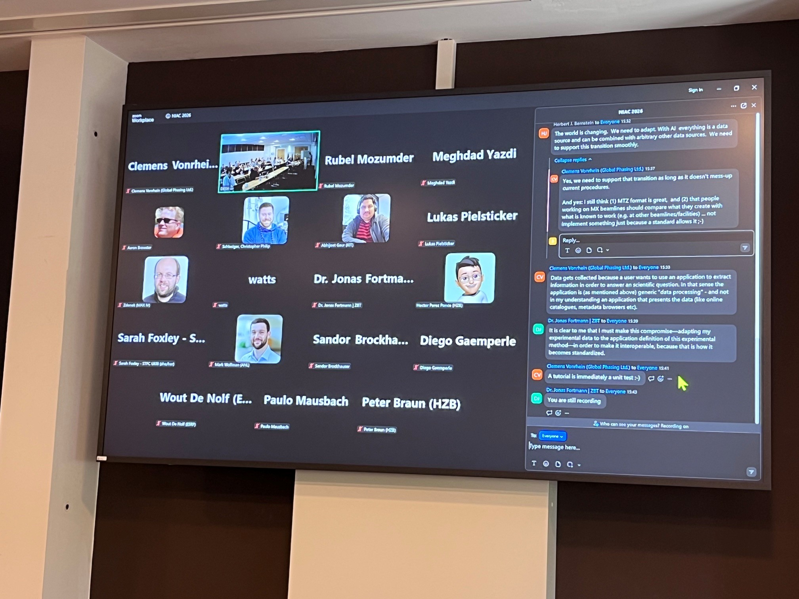
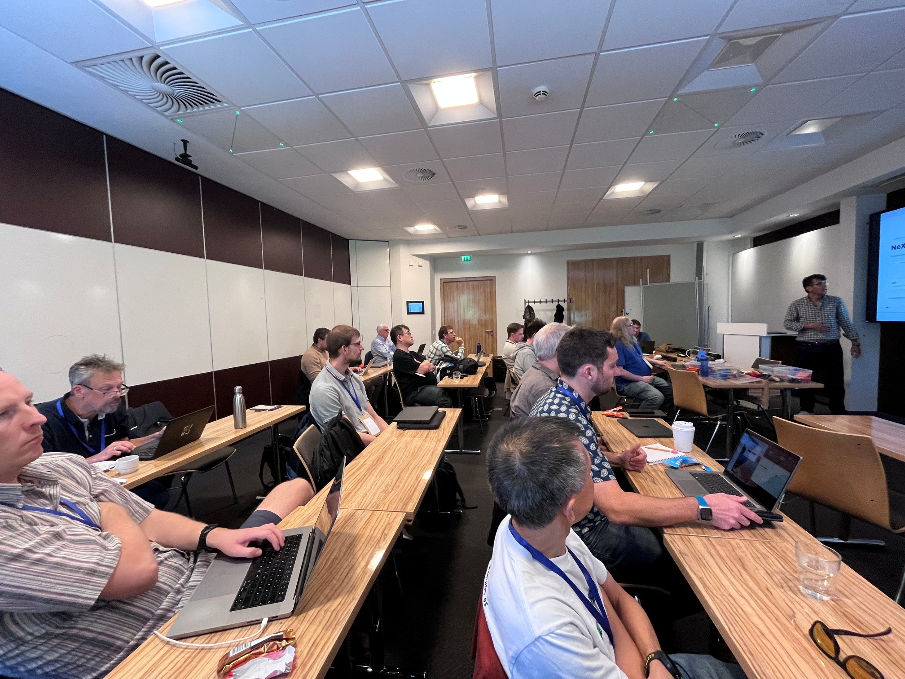
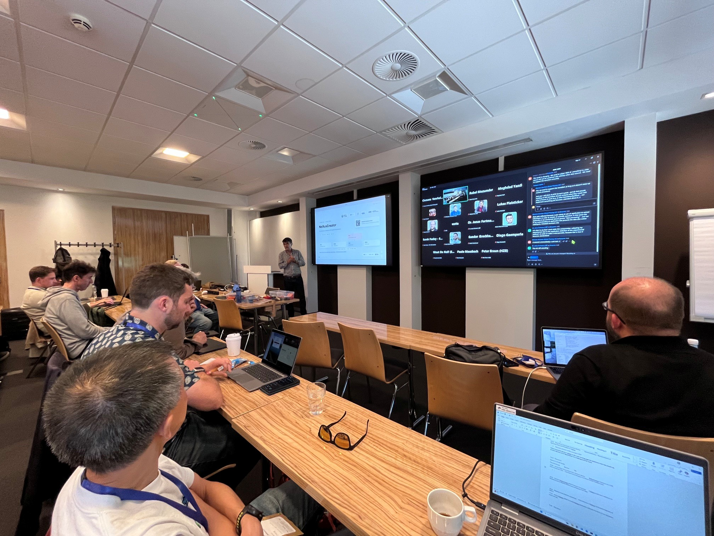
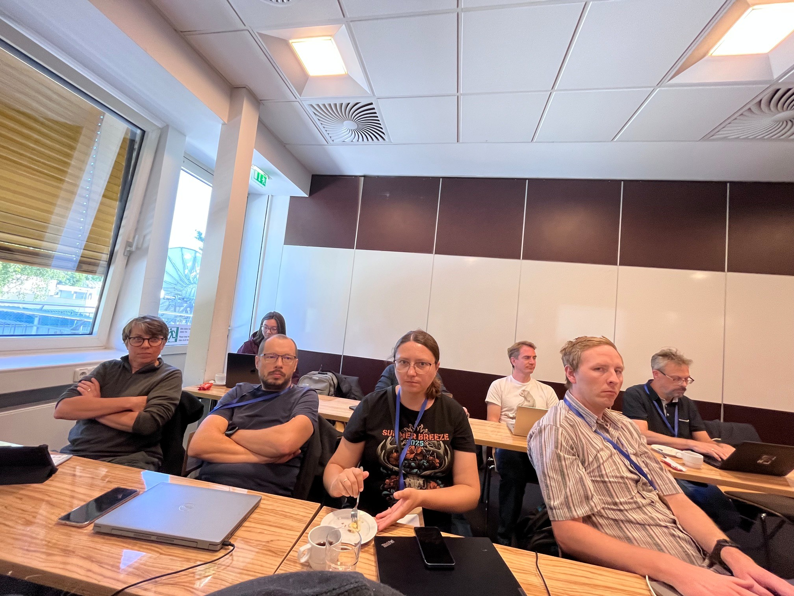
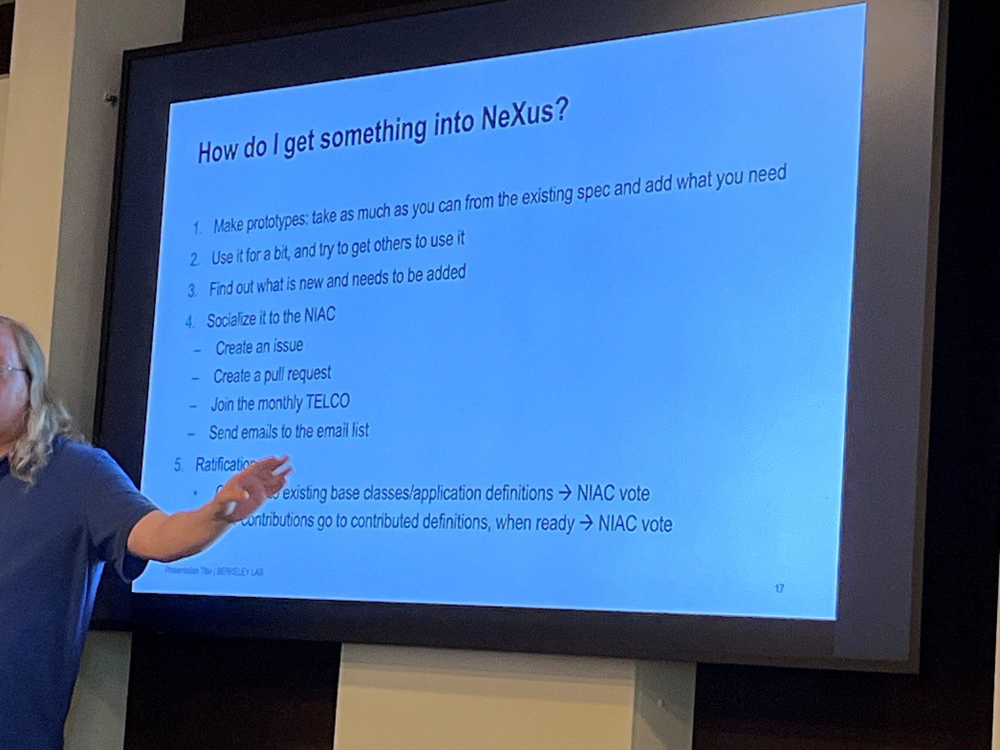

NIAC2026 Minutes
================

Participants:
-------------
- NIAC in person: AB, SB, FdA, RB, HG, WdN, PM, MW, ZM, PC, RO, MO, (TM) 
- NIAC online: HB, BW, BB, GT
- other participants:
  - Aaron Finke
  - Andre Costa
  - Renee Helfert
  - Christopher Philip Schleisinger
  - Celine Durniak
  - Erika McPhillips - SLAC
  - Mustafa Alzubi - SESAME
  - Marius Retegan - ESRF
  - George O'Neill - ESS
  - Mridul Sath - ESS
  - Diego Gaemperle - DECTRIS
  - Jonas Fortmann - ZBT
  - Iryna Lypova - FRM II / TUM
  - Jan Kotanski - DESY
  - Loas Kron-Batenburg - RDL IUCrData
  - Markus Kuehbach - FAIRmat
  - Rubel Mozumder - FAIRmat
  - Lukas Pilsticker - FAIRmat
  - Oleksii Turkot - EuXFEL
  - Paulo Mausbach - SIRIUS
  - Eva Lott - HZB
  - Peter Braun - HZB
  - Hector Perez Ponce - HZB
  - Sonal Patel - HZB
  - Sarah Foxley - ISIS, Mantid Team Lead (sarah.foxley@stfc.ac.uk)
  - Yannick Meinerzhagen - RWTH Aachen
  - Meghdad Yazdi - MAX IV
  - Jeremy Metz - MAX IV
  - Clemens Vonrhein - Global Phasing
  - Patrick Pereira - SOLEIL
  - Daniel Eriksson - Australian Synchrotron
  - Abhijeet Gaur - KIT
  - Florin Boariu - Uni Potsdam

- NIAC2026 Minutes

Session A: Sept 25th 08:00 UTC
------------------------------
- GON (ESS):
  - Status
    - JSON on top of NeXus;
    - only base classes;
    - users not understand the sandard details;
    - JSON walk & SCIPP: NXtransformation viewer;
    - most used: NXevent_data, NXdata, NXlog, NXtextlog
  - plan:
    - NeXus in the center;
    - easy XML definition extensions;
    - smoother acquistion/writer,
    - better visualisation,
    - more NX contribution,
    - integration with McStas;
    - improvments for geometries
- JK (DESY):
  - h5cpp, pninexus, pythin-pninexus writer
  - NeXpy viewer
  - AppDefs started to be used (NXmpes)
  - Need:
    - not all required fields are available, but it is now better because requirements are more relaxed
    - hdf5 performance issue with simultanious write and read 
- EL (HZB):
  - bluesky - NeXus (to NOMAD)
  - device definitions to NeXus
  - needs
    - mapping to App defs (pydentic model from NXDL)
    - referencing external asset documents
    - Tile integration
    - NXcollection -> NXbag?
- MA (SESAME):
  - no NeXus yet, but hdf5 writer is accepting template which could be NeXus
  - aim: uniform data format (e.g. NeXus: NXxas, NXmonopd, NXtomo,...)
  - bottleneck: efficient support from NIAC can  

Session B: Sept 25th 11:30 UTC
------------------------------
- EMcP (SLAC):
  - data compression in NXmx (compression level and read is good, but not ideal)
  - question: any better and standardised way?
  - saprse data: could HDF5 lib cover it? what about looking at it as event data? or as data processing/reduction result?
- LP (FAIRmat):
  - NeXus in NOMAD
  - NeXus Ontology to place NeXus Metadata into semantic ontology world
  - plan: more flexible experiment description, incl. multi-model experiments
  - need:
    - improve and clarify NXDL to describe semantics better
    - use of PIDs
    - link NeXus to external knowledge (e.g. ontologies)
    - multimodel experiments
    - how wide NeXus coverage shall be in terms of experiment techniques 
- IL (FRM II):
  - zoo of data formats
  - plan:
    - move to NeXus (and use it with Mantid, Miezepy, OpenHKL, Steca, Ufit, BerSANS...)
    - use NXtransofmration for complex geometry detector description
    - store simulation data in NeXus, too
    - also processed/reduced data should go to NeXus (like NX in Mantid)
  - questions:
    - how to best create new application definitinos
    - shall we propose new defintion or rather (miss)use not 100% fitting base classes
    - where to put unnecessary Nicos (DAQ) parameters? may be difficult to decide what is needed what is not.
    - shall we use master-file and original raw data to separate files
    - multi-modal experiments
    - how to use PIDs
    - new definitinos shall have only proper description , or name must also be  descriptive?
    - needs of the TAS (Triple Axis Spectroscopy) community? will name harmonisation needed?
    - next to new AppDefs, new base classes are also needed
- PB (HZB):
  - SECoP (Sample Environment) -> NeXus, and now more generic needs for Operando (measured during operation) experiments
  - needs:
    - multi-modal experiments
    - hardware setup description
    - link to external knowledge
    - supporting 'identifier's for fields, too, not only for groups
  - questions/comments:
    - measurements may go parallel or subsequential or overalpping
    - shall we have an NXmass_spectrometry or just describe things in NXenvironment? or somewhere else in the NeXus tree?
    - global timestamps for all subexperiments
    - global view (during the full experiment) for sensors/stages (not only in a subtechnique)
    - instead of AppDefs, maybe base classes with runtime annotation with ontology links
    - how to link a definition (and not a data item) to an ontology concept?
    - what about chemical formula which also changes during operando
- discussion:
  - what is a blocker with NeXus
    - availability of tools
    - how to use NeXus at all?
    - what to do when an application (architecture/structure) misses information
      - archiver format? interchange format?
      - sematic definition being independent from actual binary representation?
      - how to deal with only partial data?
    - how to extend the schema?
    - NXDL is a blocker; NYAML helps, but still uncomfortable unconvential rules e.g. PARTIAL names
    - generic concepts are not enough to know what is the role of a specific NXslit. use specific readable name? is it enough? external link to a specification or ontology concept? documentation in datafile? feature?...) 
  - what is the role of NIAC:
    - stear the definitions
    - also tutorials and facilitaion (better documentation) of working with NeXus? 

Session C: Sept 25th 14:00 UTC
------------------------------
- HO (HZB):
  - NeXus Creator with NXDL guided placement of (meta)data
  - questions/proposals:
    - NXDL could have better descripotions/hints for what a specific definition is for. Maybe aliases (generic choice for the name)?
    - what is the preferred way to create a file? Master file with slaves or a big file with mutiple entry or one big entry?
    - How to put description to a NeXus file (to document a specific element)?
    - No AppDef yet for operando_eis
- YM (RWTH):
  - NX Appdef for TOF powder diffraction (POWTEX instrument for multidimensional measurements) following the structure of NXsnsevent
  - plan:
    - Mantid data analysis input and output results shold also go back to the NeXus file
    - instrument parameters should be in NeXus
  - problem/question:
    - NeXus validation issues when creating a file manually (or with NXcreator)
      - cnxvalidate does not recognise partial names
      - NeXpy also shows error regarding the incorrect use of symbols
    - use of curved detectors?  
- MY (MaxIV):
  - NXazint[12]d (result of azimuthal integration type of data processing): detectors -> NeXus
  - plan:
    - NeXus for MPES techniques
  - questions:
    - what is the minimal necessary data in a NeXus file? Maybe: all what is needed by data analysis tools intended to be used by the community. Consult with local and external developpers!
    - multiple subentries in a single entry. Shall an AppDef ask for Subentries with specific Application Defintion?
- MR (ESRF):
  - AppDef family for XAS to cover all kinds of XAS based experiments with light processing
  - ESRF DAQ produced h5 files can be processed to NXxas... files after data processing
  - AI can interpret perfectly these NeXus files
  - IXAS and XAS committee of IUCr are positive
  - problems with NXxas NXxasproc:
    - not used by the community
    - rigid structure not supporting the actual experiment types
    - why two separate AppDefs? this could fit in one file
  - questions/suggestions:
    - raw data could go to NXcollection
    - NXprocess fields could reference data in NXcollection
    - What to do with data in ESRF DAQ produced hdf5 files
    - how to manage multi detection experiments
    - how deprication works?
    - how reference is modelled?
    - what about sample preparation? generic sample vs. actual sample?
- discussion:
  - suggestion for new definitions
    - make prototypes (current status and additions)
    - try in the community
    - form a proposal
    - socialize it to NIAC
      - issue
      - PR
      - Telco
      - email lists
    - Ratification
      - Change -> NIAC vote
      - new contributions go to contributed definiotions, when ready -> NIAC vote
  - New format: well accepted
  - potential new communication channels: discord, slac, matrix, zulib
  - examples and tutorials
    - mock data vs. real data
    - correct data should be available and maintained by the community
    - AI knows about NeXus and can also efficiently asked
  

Saturday Participants:
----------------------
- NIAC in person: AB, SB, FdA, HG, WdN, ZM, MW, RB, PC, RO, (TM)
- NIAC online: HB, BW, GT
- other participants: IL, JK, LP, SP, RM, GON

Session D: Sept 26th 08:00 UTC
------------------------------
- Agenda points
  - NIAC2026 Project board https://github.com/orgs/nexusformat/projects/6/views/1
    - Ready for vote
    - Ready for final check
    - Ready
    - Litle to do
    - Medium to do
    - Major to do
  - Further wishes to be discussed
    - WdN: NXxas
    - HG: Operando related questions
    - RB: example repo and its visibility
    - FdA: community wishes, communication
    - MW: tutorials, documentaion
    - LP: target attribute, ontology
    - ZM: cleaning the documentation, NXazint
- AB: Has the NIAC the right size? Are we agile enough?
  - at the moment:
    - 20 voting members at the moment
    - 2/3 requirement: 13 votes
    - some inactive members
  - BW: more contributing members would be better, but inactive members are a bottleneck. Clear advertisement of the expectations. Maybe: setting up a new role those who want to be involved, but shallnot necessary hold a volting right: contributing NIAC members? (e.g. MK, LP, etc.) and have specific category for NIAC voting member.
  - AB: member list could also include the expertise and interests of specific contributing members.
  - AB: corum requirement should be reduced. 50%?
  - BW: rather separate the voting and non-voting members
- AB: do we need a new NIAC responsibility?
  - now: spec, examples, validator
  - new: tutorial?
  - AB: do we miss medium level tutorials?
  - IL: working, real facility examples with explanation why they are put together as they are
  - LP: how to write new definition and how to contribute to NeXus
  - HG: how to start with something new, like pump-probe experiments
  - MW: separation between Using and Developping NeXus
  - RB: maybe an AI prompt on top of the documentation?
  - WdN: move away from XML and use pydantic
  - AB: cleaner and simplified documentation (e.g. doctree is full with unrelevant topics)
    - LP: https://fairmat-nfdi.github.io/pynxtools/tutorial/writing-an-application-definition.html
    - HG: https://hz-b.github.io/2026_BESSYII_Datathon/
  - HB: SQL ontology is needed for human tracibility
  - AB: let us create an issue for this
- AB: make examples more visible
  - Examples on the main page
  - Examples for each App Def
  - More community examples (links?)
  - NeXus file interpretor (tool to connect NeXud groups/fields/attrs in a data file to Vocabulary Items of the NeXus definitions)
  - github action for checking defintions (and definitions changes) against known example data files
  - diataxis for examples and documentation in general
  - Code-Camp for it
- NIAC Roles
  - Technical Manager
    - existing, but unfilled role for NAPI that is not there anymore
    - instead, an official validator could be added as a task for this role
    - RO: cnxvalidate is there but not developped any longer. Python API could be strangthened by more contributors (e.g. with pynxtools)
    - BW: single source of truth in NeXus is the defintion in NXDL. It shall not be the validator which provides the truth. A validator is good, but it should follow the NXDL definitions. Can a single person be responsible for guaranteeing integrity between definitions and validation? Tech manager shall be responsible for the validation tool and we also need one for managing NXDL.
    - HB: NeXus connectivity to databases should be enabled. Database referential integrity should be maintained via normalisation.
      - SB,LP: NOMAD (in FAIRmat) solves the probelm using mongoDB
      - HG: ontology, triplets and SPARQL is also a way (DAPHNE is looking at) 
      - AB: we need a specific example to demonstrate the actual probelm
  - Ontology Manager
    - it can be defined as an official role
    - ensures the relationship with semantic world
  - NIAC Executive Chair
    - FdA is volunteering
    - SB seconded
    - noone else volunteered
    - accepted (13/0/0)
  - NIAC Executive Secretary  
    - RB is volunteering
    - RO seconded 
    - noone else volunteered
    - accepted (13/0/0)
  - NIAC Definition Release Manager  
    - PC is volunteering
    - RB seconded 
    - noone else volunteered
    - accepted (13/0/0)
- PR #1331
  - BW: allowing multiple mirrors, we may want to give an attribute for the role of the mirror
  - PC,SB: NXcomponent already allows the description of even complex beam paths, so even more than just a role can already now be described
  - GT: it is not clear why NXmonochromator exists at all if NXcomponent would be just enough
  - AB: put the questions into an issue
  - accepted (11/0/2)

Session E: Sept 26th 11:30 UTC
------------------------------
- PR #1327
  - RO: why not an NXenvironment for (every) NXcomponent
  - LP: yes, but specializing an NXinstrument with special description provides a possibility for a recepie how to describe its environment
  - WdN: Warning! NXenvironment has NXcomponents, so an NXcomponent would have NXcomponents inside.
  - AB: just take it as is. Note that if a subcomponent has an environemnt already defined (e.g. Sample) than that this environemnt should be used instead.
  - BW: an environemnt should be external to the component it is providing environment for.
  - SB: Can an NXinstrument has another NXinstrument inside? Similarly, an NXcomponent another NXcomponent inside?
  - AB: We can support the specific requests as they are coming.
  - BW: +1, We can now add where it is now requested and if new request comes, we can then add there, too.
  - HG: Operando project is addressing this question, so we may wait until the request is clarified.
  - SP: as BW said, we can add it to both places
  - GON: be carefull with its use
  - AB: go for it with clear description
  - RO,SB: specialisation of excluding the possibility to have an NXenvironemnt in /NXcomponent/NXsensor and NXactuator is not needed.
  - accepted (11/1/1)
- PR #1330
  - accepted (13/0/0)
  - BW: documentation could be further clarified that both funtion and/or mechanism can be described here.
  - AB: this documentaion improvment does not need a special vote
- PR #1654
  - SB: original aim was to warn people not to write free text, but rather reference existing documentation (e.g. ISO standard, Instrument manual, etc.) if possible. This is actually a general rule, and can be made clear as a general idea in the documentaion, rather then writing it everywhere. 
  - accepted (12/0/1)
- PR #1653
  - PC: Is is needed at Diamond and shall be used in NXdetector
  - RO: It is like a view definition. Is not this definition too specific?
  - PC: Indeed, if it needs to be extended, it can be done.
  - GON: signal and aux_signal in NXdata shall be consistant. Different downsampling requires multiple NXdata results.
- What is in front of us:
  - AFM/SPM PR#1632
    - 5 App Def
    - 16 Base Classes
    - rendered documentation is under https://fairmat-nfdi.github.io/nexus_definitions/classes/contributed_definitions/spm-structure.html
  - XAS PR#1619
  - @target 

Session F: Sept 26th 14:00 UTC
------------------------------
- PR#1619 XAS (see also PR#1352)
  - AB: community needs NXatom and NXelement as separate concepts
  - SB: NXelement: why do we have long enum list with docuemtation repeating well known physics standard?
  - BW: NXauger_line/NXemission_line: why an enum list rather than a regexp?
  - WdN: auger lines do not seem to be a complete list
  - PC: The list in current base class does not support properly neutron spectroscopy
  - BW: next to element, a separate definition is needed for isotopes
  - AB: Would not it be enough to add mass number to NXelement?
  - HG: enumeration allows ontology mapping to external knowledge base.
  - NIAC suggestions and questions are posted to the PR
  - WdN: request was to keep it in contributed
  - AB: if community agrees, this could go to the standard base classes directly
  - accepted with the notes (12/0/1)
- PR #1640 XAS
  - WdN: AppDefs are requested to stay contributed for the time being
  - NIAC discussed several topics and put suggestions into the PR

Sunday Participants:
----------------------
- NIAC in person: AB, SB, FdA, HG, WdN, ZM, RB, PC, RO, (TM), MW, 
- NIAC online: HB, BW, GT
- other participants: IL, JK, LP, SP, RM, GON

Session G: Sept 27th 08:00 UTC
------------------------------
- 1. Constitutional Roles and Structure

  - Discussed Points
    * Validation tool descriptions should remain generic rather than mandating specific tools (such as `cnxvalidate` or `punx`), granting the manager flexibility to choose tools.
    * Titles should use a consistent phrasing format (`Validation Technical Manager`, `NXDL Technical Manager`, `Ontology Technical Manager`) rather than colons.
    * The ontology role must oversee registration in registries (e.g., W3id), maintenance of terminology mappings, and schema mechanisms that allow files to reference external ontologies directly.
    * With 13 of 20 voting members present, changing the constitution required a unanimous vote to meet the two-thirds threshold.

  - Decisions
    * Approved standardized naming conventions for the technical manager roles.
    * Unanimously approved the constitutional amendment establishing the technical manager roles.
    * Heike was nominated, seconded, and unanimously elected as `Ontology Technical Manager`.
    * Wout De Nolf was nominated, seconded, and unanimously elected as `NXDL Technical Manager`.
    * Nomination and appointment for `Validation Technical Manager` was deferred for offline discussion.

---

- 2. XAS Definitions and `NXtrans` (PR 1640)

  - Discussed Points
    * Soft X-ray beamlines utilize mirror/grating monochromators without crystal d-spacing, requiring an explicit resolving power/energy resolution parameter in `NXmonochromator` instead of relying on crystal properties.
    * Spectroscopy beamlines commonly output tabular ASCII data; using `NXcollection` or `NXnote` permits raw ingestion without prematurely enforcing standard NeXus structures.
    * Allowing broad MIME types in `NXnote` or `NXprocess` introduces the danger of users storing arbitrary binary data or executable scripts inside NeXus files.

  - Decisions
    * Add an explicit resolving power / energy resolution field to the `NXmonochromator` base class and mark it as recommended in the application definition.
    * Maintain generic process descriptions while adding explicit notes advising users against embedding executable code.

---

- 3. Deprecation of Legacy `NXxas` and `NXxas_proc`

  - Discussed Points
    * The legacy `NXxas` application definition is outdated and broken, though a reference implementation exists in Sardana.
    * Completely deleting definitions is overly disruptive, while maintaining identical class names in both the application and contributed directories causes conflicts in validation tools.
    * Marking old fields as deprecated and adjusting documentation rendering preserves backward compatibility while promoting modern definitions.

  - Decisions
    * Unanimously passed a resolution to deprecate and demote `NXxas` and `NXxas_proc` from application definitions to contributed definitions via a future pull request.
    * Deprecated fields will be hidden by default in rendered documentation via collapsible sections.
    * New XAS definitions will be layered on top of the contributed classes.

---

- 4. Agenda and Session Planning

  - Discussed Points
    * Core scientific topics (STM, AFM, APM) should be prioritized ahead of procedural discussions due to several participants needing to depart early.

  - Decisions
    * Allocated the upcoming session to STM, AFM, and APM discussions.
    * Scheduled remaining procedural and structural topics for the subsequent session.

---

- 5. Communication Tools and Mailing Lists

  - Discussed Points
    * The existing mailing list structure is fragmented across `nexus`, `nexus-committee`, `nexus-tech`, and `build-server`.
    * `build-server` and `nexus-tech` are unmaintained and obsolete.
    * Routine announcements and teleconferences require a broad audience, while committee voting requires restricted distribution.
    * Slack imposes pricing and archive limits without self-hosting options; Zulip is open-source, free for qualifying projects, supports threaded discussions, and provides mobile apps with notifications.

  - Decisions
    * Retire the `build-server` and `nexus-tech` mailing lists.
    * Standardize on `nexus@nexusformat.org` for community announcements, meeting links, and open discussions.
    * Restrict `nexus-committee@nexusformat.org` strictly to committee business and official voting.
    * Submit a pull request to update the NeXus manual and documentation to reflect the mailing list consolidation.
    * Accepted Greg's proposal to set up and test a Zulip instance for the NeXus community.

Session H: Sept 27th 11:30 UTC
------------------------------

- 1. Handling Links and the `target` Attribute in NXDL/XSD

  - Discussed Points
    * The `target` attribute is currently present in the schema (`nxdl.xsd`), but there is confusion between XML attributes and NeXus HDF5 attributes.
    * In HDF5 implementations, links are represented as `NXlink` objects where the underlying `target` attribute indicates a link target, but this implementation detail is largely hidden from the end user.
    * Allowing abstract or generic fields with `target` attributes in base classes or application definitions creates validation issues (validators either fail or produce false positives).
    * Direct usage and direct validation of such abstract link structures should be suppressed or marked with deprecation warnings.
    * Documentation should be rewritten to explain how field names and targets work in practice rather than using abstract computer science terminology.

  - Decisions
    * Agreed to add documentation and comments to the relevant pull request clarifying how fields and targets interact during validation without introducing breaking schema changes.

  - Exchanges
    * PR #1558 add target attribute to NXobject using new field super-type https://github.com/nexusformat/definitions/pull/1558
      * LP: started discussion going over the PR
      *  WdN: type should be an enumerated type, because type could be any string at the moment.
      * LP: things like "target" are not defined in XSD file so a validator cannot validate it because it has no definition what a target link is
      * AB: changed the wording of Field names with all caps
      * LP: its fine to leave this open but it should be addressed.
      * RO: can any list of attributes be added to any field?
      * LP: lets leave this open and then let WdN finish his work on the XSD file
---

- 2. Mathematical Logic and Calibration Formulas in NeXus Files

  - Discussed Points
    * **Need for Expression Storage**: Detectors (such as Jungfrau) store 16-bit integer raw data where high bits represent gain/mask states. Converting raw data to calibrated data requires bit shifts, bitwise AND/OR, and arithmetic with calibration constants. Storing 16-bit integers with a formula saves massive storage compared to storing pre-computed 32-bit floats.
    * **Security & Vulnerability Risks**:
    * Allowing executable formulas or instruction sets creates severe security risks (e.g., remote code execution, macro-like exploits, AST escape vulnerabilities, or execution bombs).
    * Data files are routinely ingested by unvetted scripts and automated pipelines across facilities. Even if a safe whitelist/grammar is specified, third-party implementations may resort to unsafe methods (e.g., `eval()`).
    * "NeXus shall not be code" — logic and data must remain strictly decoupled to avoid exposing facilities to malicious actors.
    * **Alternative Approaches Discussed**:
    * Implementing hardcoded, constrained classes (e.g., `NXtransformations` approach, or an `NXmath` class with predefined binary operations).
    * Utilizing the NeXus features repository (`NXentry.features`) where vetted algorithms and IDs are referenced rather than carrying raw formulas in the file.
    * Human-readable text descriptions in documentation fields rather than machine-executable formulas.

  - Decisions
    * Rejected the proposal to introduce executable formulas or mathematical grammars into NeXus definitions.
    * The corresponding issue will be closed as "not planned."
    * Calibration and custom processing logic will be handled outside the core NeXus files (e.g., via HDF5 plugins or dedicated external analysis tools).

  - Exchanges
    * PR #711  MATH support in Nexus
      * AB: presents the issue with an example of calibrating data in NXmx
      * FD: ? could just use arrays to hardcode the calibration
      * BW: if you allow any kind of general instructions in Nexus, someone somewhere will just execute it without checking which could causes infections in lab systems, 
      * AB: I cant write this specific equation in NXmx its too complicated, this calibration is a function of the detector so it is changing all the time, 
      * GO: shares screen, AST example: arbitrary bit shifts could be a big problem
      * HB: we are in a new world, bad actors, have to take the position that nothing should ever get automatically executed by our files
      * SB: we have a solution in the nexus family already, we have a "features" repo, in there you can specify that this feature is "implemented this way", in teh data file you specify the "feature ID", these things can be used to check the integrity of your data file. 
      * MW: AB who would use these expressions?
      * AB: anyone using a Jungfrau detector
      * HB: I know people currently working in cybersecurity, BW is right, AB is right its a need, you need a independent third party to review the problem and the solutions, and be patient until all involved need to be comfortable before moving forward.
      * FD: true, with FAIR we want reproducibility, and describing what was done is a possible risk.
      * BW: if we dont do anything at all, other people may start to standardize and make the mistake themselves so doing nothing is also a problem.
      * SB: BW is right we have this problem and we have had this problem and every 2 years we decide to do nothing, 
      * AB: would like to close the issue as not planned
      * BW: so long as we keep the logic out of the data files we wont have to deal with the fallout of bad actors
---

- 3. Symbols and Array Dimensionality in Base Classes

  - Discussed Points
    * **Redundant Symbols**: An automated audit of NXDL definitions revealed many "singleton" symbols (symbols declared or applied to only a single field with no counterpart to validate equivalence against), creating clutter without functional benefit.
    * **Overly Constrained Base Classes**:
      * Defining rigid ranks in base classes (e.g., requiring rank 4 for `NXdetector/data`) throws validator warnings against valid files using 1D, 2D, or variable-rank detectors.
      * The core issue is fixing dataset dimensionality at the base-class level when detectors vary widely by experiment.
    * **Base Classes vs. Application Definitions**:
      * Symbols are primarily beneficial in application definitions where full experimental context and array equivalences between fields are established.
      * Application definitions composing multiple base classes face symbol collisions (e.g., two detector instances with different dimensions), as NXDL currently lacks namespacing or inheritance-override mechanisms for symbols.

  - Decisions
    * Clean up redundant singleton symbols from base classes and convert them into plain text descriptions in the documentation.
    * Existing validator errors stemming from base-class symbol mismatches are downgraded to informational messages.
    * Further review of the generated symbol-cleanup pull request was deferred to GitHub for community feedback.
    
  - Exchanges
     * PR #1659 Improvements to the use of symbols in NXDL Base Class Definitions 
       * RO: presents case for why symbols should be removed from Base classes, PR was generated by changes suggested by Claude, motivated by outputs from the nexpy validator
       * WdN: The issue is the specification of dimensionality in base classes not the symbols, once you have rank then symbols are useful, 
       * PC: I think this is an over simplification, 
       * SB: you can have 'i' used in NXdetector and 'i' used in another base class and the two are different yet both used in an application definition
       * WdN: PR #1650, reused symbols do not cause collisions,  
       * FD: please continue the discussion in GH issues

Session I: Sept 27th 14:00 UTC
------------------------------

- NIAC in person: AB, HG, WdN, MW, RB, RO, FD, 
- NIAC online: GO, BW, HB
- other participants: LP
------

   - Exchanges
      * AB: was approached be xtallographers to add NXdose PR # 1658
      * AB : presents #1658, gets feedback and makes comments in files of PR
      * HG: expressed support for adding this
      * very favorable response from comments

- 1. SPM and AFM Application Definitions and Base Classes

  - Discussed Points
    * **Scope and Hierarchy**: Scanning Probe Microscopy (SPM) encompasses Atomic Force Microscopy (AFM), Scanning Tunneling Microscopy (STM), low-temperature SPM, and force spectroscopy. A parent application definition (`NXspm`) is designed to specialize into specific sub-techniques while sharing common base classes.
    * **Community Tools & Vendor Adoption**: FAIRmat developed a converter tool mapping third-party vendor formats to NeXus. Commercial vendors are supportive in discussions but typically will not commit engineering resources to write exporters until definitions are formally accepted into the NeXus standard.
    * **Strict Enumeration for Scan Types**:
      * Scans (e.g., spiral, snake) require dedicated parameter groups depending on the chosen scan mode.
      * Keeping the `scan_type` enum closed ensures that new scan modes cannot be introduced at runtime without corresponding schema definitions for their parameters.
    * **Sample Environment vs. Scan Definition**: The SPM community groups sample stage positioning and scan trajectories into the sample environment group. While conventional NeXus separates physical environment (e.g., temperature) from motion/instrument control, SPM treats sample position as part of the local environment.
    * **Coordinate Systems**:
      * SPM experiments involve separate motions for the sample, the tip cantilever, and the piezo sensor, each reporting local XYZ displacements without explicit reference origins.
      * Because SPM lacks a beam, standard NeXus coordinate conventions (where $+Z$ points along the beam direction) cannot apply. Explicit `NXtransformations` and coordinate frames must be declared to define tip-sample relationships.

  - Decisions
    * Subgroups reviewed the base classes and submitted line-by-line feedback directly onto the GitHub pull request.
    * Retained strict enumerations for scan types where explicit parameter groups map to the scan method.
    * Required the authors to integrate explicit coordinate system definitions and `NXtransformations` into the documentation to clarify tip, piezo, and sample references.
    * Feedback was compiled for the FAIRmat and SPM community authors to revise before final merging.
  
  - Exchanges
     * PR #1632
      * LP: presents PR, scanning probe microscopy
      * SB: vendors are very interested but wont implement it until there is a standard
      * LP: break into smaller groups to tackle blocks of the changes for review
      * AB: what's our procedure? 
         - read the base classes and our subgroup and add comments to the pull request.
         - comments also allowed on the file itself
      * group returned:
        * comments have been left on GitHub
        * AB: we should look at the application definitions
        * LP: look at the application definitions
        * LP: goes through NXspm, 
        * AB/RO: labs using nexus for things that do not have beams etc is a good thing 
        * BW: we should be community minded, growth is great as long as our resources grow with it
        * LP: the SPM community like the idea of using nexus because its 30 yrs old,
        * AB: lets write a statement and vote on it inviting people from other communities to join the NIAC
        * LP: feels that people from the SPM/AFM community would be interested in joining if there was a way

---

- 2. NeXus Scope and Inclusion of Non-Beam Communities

  - Discussed Points
    * **Mission Creep and Committee Bandwidth**:
      * NeXus was conceived around large-scale beamline facilities (synchrotrons, neutron sources, XFELs) involving a source, beam, sample, and detector.
      * Expanding into non-beam techniques (SPM, AFM, electron microscopy, catalysis) risks making NeXus a generic repository for all scientific data, which a voluntary 20-member committee meeting biennially lacks the expertise and bandwidth to oversee.
    * **Multimodal Science and Standard Ecosystem**:
      * Cross-facility and multimodal workflows routinely combine techniques (such as AFM with crystallography or spectroscopy). NeXus provides an established ecosystem of HDF5 conventions, metadata dictionaries, APIs, and validation tools.
      * The scientific expertise comes from the incoming communities themselves, not solely from existing committee members.
      * Broadening adoption strengthens the case for funding agencies to support NeXus infrastructure.
    * **External Standards and Duplicate Schemas**:
      * External communities that already maintain functional schema ecosystems (e.g., JSON schemas or ontologies in catalysis or electron microscopy) should not be forced into redundant NeXus schemas. NeXus should focus on crosswalks and mappings rather than recreating existing external standards.
    * **Representation**: If non-beam communities wish to adopt NeXus, their representatives should be officially integrated into the NIAC (via voting or non-voting membership) to maintain and support their respective definitions.

  - Decisions
    * **Resolution Approved**: Proposed and unanimously voted in favor (11 votes in favor, 0 opposed) of the following official statement:
  > *"NIAC is open to members from new interested communities from facilities and organizations that are not beam-related."*
    * Non-voting member roles will be used as an immediate vehicle to onboard representatives from non-beam techniques (such as FAIRmat and SPM representatives).

  - Exchanges
      * Statement put forward for a vote:
      * The proposal is that the NIAC is open to accept members from new interested communities from facilities/organizations that are not beam related.  

         - votes: 
         - 11 votes for
         - 0 votes against
         - 0 abstain

---

- 3. Radiation Damage and `NXdose` (Diamond Light Source Proposal)

  - Discussed Points
    * **Need for Dose Tracking**: Modeling radiation damage and absorbed dose is essential across macromolecular crystallography (MX), 4th-generation synchrotrons, cryo-EM, and spectroscopy to track beam-induced sample degradation.
    * **Generalization vs. Technique-Specific Fields**:
      * The proposed `NXdose` base class includes absorbed dose, peak dose, dose rate, dose targets, thresholds, and time series across scan points.
      * However, the PR inappropriately included MX-specific and diffraction-specific parameters (such as goniometer angles, Garman limits, relative diffraction efficiencies, and diffraction wedge fractions) within the generic base class.
      * A base class must remain applicable to spectroscopy and other fields; MX-specific metrics should reside solely within the `NXmx` application definition.
    * **Sample Modeling**: Tracking localized damage requires correlating the dose time series against a spatial/voxelized model of the sample as it undergoes beam exposure.

  - Decisions
    * Strong general consensus and support for incorporating dose and radiation damage tracking into NeXus.
    * Reviewers must ensure technique-specific properties (e.g., goniometer angles, MX-specific limits) are decoupled from the generic `NXdose` base class and moved into `NXmx`.
    * Authors will evaluate linking `NXdose` with other application definitions (e.g., `NXem` and spectroscopy definitions).

---

- 4. Administrative and Meeting Operations

  - Discussed Points
    * Distributing teleconference links via plain text emails leads to recurring time-zone confusion (UTC conversions) and missed meetings.
    * Third-party scheduling tools (like Doodle) impose restrictive feature limits.

  - Decisions
    * The next monthly NIAC teleconference will take place in October.
    * Future meeting invitations will include standardized `.ics` calendar file attachments to facilitate automatic calendar imports and time-zone conversion.

Closing out the session and end of NIAC meeting.